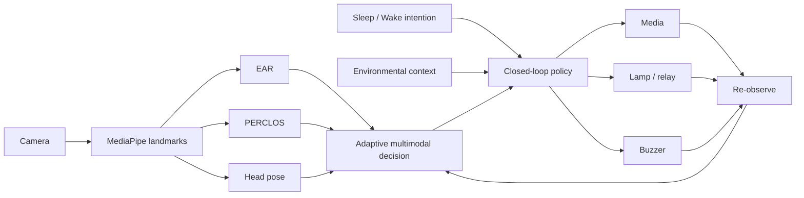
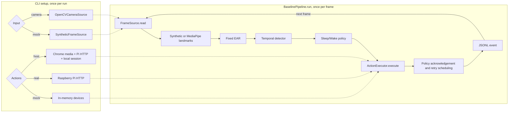

# System Architecture

This document separates the implemented Phase 2 fixed-EAR baseline from the planned Phase 3 detector. The system follows:

```text
state detection -> intention-dependent actuation -> re-observation -> restoration or policy transition
```

## Implementation stages

| Stage | Status | Scope |
|---|---|---|
| Original class project | Preserved reference | MacBook, Chrome, Raspberry Pi, fixed EAR, and the original local dashboard |
| Phase 2 / B0 | Software implemented; a team-reported physical demonstration is documented | Modular CLI, fixed EAR, closed-loop policy, action adapters, and JSONL logging; see the [November 5 record](PHYSICAL_DEMO_2026-11-05.md) |
| Phase 3 / B1–B3 | Planned | Integrated Adaptive EAR, PERCLOS, and head-pose ablations |

Adaptive EAR, PERCLOS, head pose, and environmental context in the first diagram are **targets**, not validated baseline features.

## Planned detector and system



## Current Phase 2 execution path



The CLI creates the selected input and action adapters once. Re-observation reads the next frame from the same `FrameSource`. At end of input or user exit, `BaselinePipeline.close()` attempts owned-resource cleanup. `--input mock --actions mock` is a repeatable software check. `--input camera --actions real` sends every action to Pi HTTP; the Pi media endpoints only acknowledge requests. `--actions host` controls media on the macOS Chrome host, light and buzzer over Pi HTTP, and session state locally.

## Module boundaries and dependencies

- `capture`: OpenCV camera source and deterministic fake frames; the camera adapter owns `VideoCapture` cleanup.
- `pipeline`: `FrameSource`, `LandmarkProcessor`, `DrowsinessDetector`, `ActionExecutor`, and `EventLogger` contracts; `BaselinePipeline` orchestrates them synchronously.
- `detection`: EAR geometry and time-based states. Adaptive calibration and PERCLOS modules are preliminary and are not used by the B0 CLI.
- `control`: intention-specific transitions, recovery, and action retries, without direct hardware access.
- `adapters`: mock devices, bounded Pi HTTP executor, Pi action service, and macOS Chrome media control.
- `eventlog`: validated JSONL events, run metadata, privacy redaction, and summary; see [LOGGING_SCHEMA.md](LOGGING_SCHEMA.md).
- `config`: environment settings and experimental parameters.
- `legacy`: unmodified submitted runtime implementation.

Core detection and policy code depends on data values and protocols, not OpenCV, MediaPipe, HTTP, or GPIO imports. A face that is not detected yields `None` from the landmark processor and then `NO_FACE`; capture or processing failures raise errors instead.

`create_landmark_processor()` selects `MediaPipeFaceMeshProcessor` when legacy `mediapipe.solutions` exists, or `MediaPipeFaceLandmarkerProcessor` for the Tasks API. Both expose the same eye landmark indices and pixel coordinates: left `(33, 160, 158, 133, 153, 144)`, right `(362, 385, 387, 263, 373, 380)`. The processor owns a native resource and must be closed.

## Timing and failure semantics

`Frame.timestamp` and the pipeline clock use the same monotonic source. `PipelineEvent` records sequence, EAR, state, actions, action results, and latency fields. `PipelineEvent.landmark_latency_ms` covers landmark extraction, while `PipelineEvent.inference_latency_ms` covers EAR calculation and the detector update after extraction. In JSONL, `inference_latency_ms` covers the full landmark-to-state interval. `control_latency_ms` covers policy and actions. `end_to_end_latency_ms` runs from capture to the last action result. Logging is excluded. See [LOGGING_SCHEMA.md](LOGGING_SCHEMA.md) for exact fields and units.

Capture, landmark, detection, policy, and logging failures propagate because the observation is unreliable. Expected action failures return unsuccessful `ActionResult` values and do not stop re-observation. Unexpected executor exceptions are converted to unsuccessful results so remaining actions can run. A result for the wrong action is a contract violation.

The Pi HTTP executor uses `POST` for state changes, refuses redirects, enforces a timeout, and records stable failure reasons without logging URLs or response bodies. See the [physical-device guide](RASPBERRY_PI_SMOKE_TEST.md).
