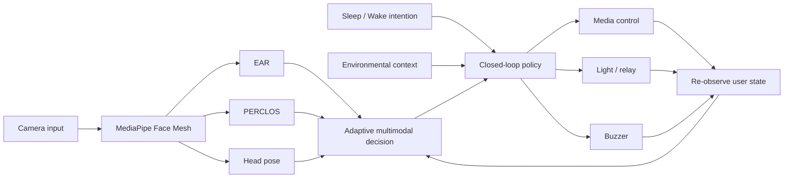
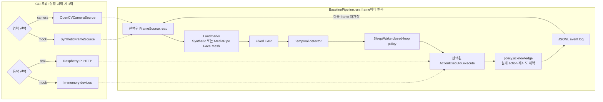
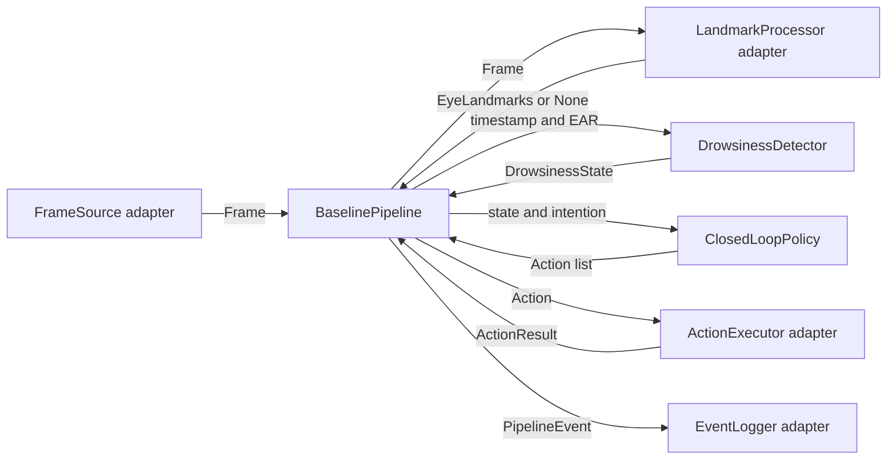

# System Architecture

The research system follows a closed-loop pipeline rather than a one-shot alert.

## 구현 단계 구분

| 구분 | 상태 | 목적 |
|---|---|---|
| Legacy 수업 프로젝트 | 보존·재현 대상 | MacBook, Chrome, Raspberry Pi를 연결한 최초 동작 기준 |
| Phase 2 Fixed EAR baseline | 현재 구현 | 모듈 경계, CLI, 구조화 로그, mock 재현성과 실제 장치 연결 |
| Phase 3 multimodal detector | 계획 | Adaptive EAR, PERCLOS, Head Pose ablation |

아래 첫 번째 그림은 **Phase 3 목표 구조**를 포함합니다. 따라서 Adaptive EAR,
PERCLOS, Head Pose, environmental context는 현재 baseline의 완료 기능으로 해석하면 안
됩니다. 두 번째 그림이 현재 Phase 2에서 실행 가능한 구조입니다.

## Phase 3 목표 구조(계획)

## Phase 2 실행 구조(현재)

입력과 동작 어댑터는 CLI가 실행 시작 시 한 번만 선택·초기화합니다. 재관찰은 입력을
다시 선택하는 것이 아니라 이미 선택된 `FrameSource`에서 다음 frame을 `read()`하는
반복이며, frame이 없거나 사용자가 종료하면 `BaselinePipeline.close()`가 남은 cleanup을
실행합니다.

CLI가 composition root 역할을 하며 core pipeline은 OpenCV, MediaPipe, HTTP 또는
파일시스템 구현을 직접 import하지 않습니다. `--input mock --actions mock`은 CI와
로컬 검증용이고, `--input camera --actions real`은 실제 장치 시연용입니다.

## Module boundaries

- `detection`: feature extraction, calibration, temporal classification
- `control`: intention-aware state transitions and restoration policy; it emits
  actions but does not directly access GPIO, HTTP, media, or camera APIs
- `pipeline.models`: immutable data passed between modules (`Frame`, eye
  landmarks, 좌·우·평균 EAR/state event, 처리 latency, requested actions, and
  execution results)
- `pipeline.contracts`: environment-independent `Protocol` interfaces for
  `FrameSource`, `LandmarkProcessor`, `DrowsinessDetector`, `ActionExecutor`,
  and `EventLogger`
- `pipeline.runner`: synchronous orchestration only; it owns no camera, MediaPipe,
  network, filesystem, or GPIO implementation
- `adapters`: hardware-free mock and bounded Raspberry Pi HTTP action executors
- `capture`: OpenCV camera adapter and deterministic fake frame source; camera
  acquisition errors stop the run and the adapter owns `VideoCapture` cleanup
- `eventlog`: JSONL `EventLogger` implementation, run metadata, schema validation,
  and redaction; see [LOGGING_SCHEMA.md](LOGGING_SCHEMA.md)
- `config`: environment-specific values and experimental parameters
- `legacy`: original submitted prototype kept as a reproducible reference
- `data`: consented experiment data; raw data is intentionally ignored by Git
- `results`: generated metrics, tables, and figures; generated files are ignored

## Closed-loop behavior

1. Detect the current state.
2. Select actions using Sleep Aid or Wake-up intention.
3. Actuate media, light, and/or buzzer.
4. Observe the user again.
5. Restore devices or transition policy when the user recovers.

## Baseline contracts and dependency direction

Core detection and policy code depends only on values and contains no adapter
imports. `BaselinePipeline` depends on the five structural interfaces, while
camera/MediaPipe, HTTP/GPIO/media, and persistent logging implementations depend
on those interfaces from the outside. Test fakes therefore use the same public
contracts as production adapters without requiring optional hardware packages.

`Frame.timestamp` is the capture time from a monotonic clock. 얼굴이 정상적으로
검출되지 않은 경우 `LandmarkProcessor.process`는 `None`을 반환하고 pipeline은
detector에 `ear=None`을 전달하여 `NO_FACE`를 생성합니다. 반면 입력 형식, OpenCV
변환 또는 MediaPipe 실행이 실패하면 `FaceMeshProcessingError`가 발생하므로 정상적인
미검출과 처리 오류가 구분됩니다.

`MediaPipeFaceMeshProcessor`는 legacy와 동일한 왼쪽 눈
`(33, 160, 158, 133, 153, 144)`, 오른쪽 눈
`(362, 385, 387, 263, 373, 380)` 순서를 사용합니다. 결과에는 전체 face mesh와
양쪽 눈의 pixel-space landmark가 포함됩니다. 이 객체는 context manager 또는
`close()`로 MediaPipe native resource를 정리해야 합니다.

`PipelineEvent`는 frame sequence와 timestamp 외에도 좌·우·평균 EAR,
`landmark_latency_ms`, `inference_latency_ms`, 상태, 요청 action 및 실행 결과를
기록합니다. landmark latency는 `LandmarkProcessor.process` 구간이고 inference
latency는 EAR 계산과 시간 기반 상태 갱신 구간입니다. policy, 장치 실행, logger
자체의 소요 시간은 두 측정값에 포함하지 않습니다.

`BaselinePipeline` accepts a `clock` (default `time.monotonic`) that must be the
clock used for `Frame.timestamp`. It measures, per frame, inference latency
(landmarks, EAR, detection), control latency (policy and all actions), each
action's execution latency, and end-to-end latency from capture to the last
action result. Logging time is excluded. Wall-clock time is added only by the
event logger for correlation, never for durations.

## Error policy

- Frame capture, landmark processing, EAR calculation, detection, policy, and
  logging errors propagate to the caller. `FaceMeshProcessingError` is therefore
  never silently converted to `NO_FACE`. These failures make the observation
  unreliable or unauditable, so the run controller must stop or restart it.
- `ActionExecutor` should normally return an unsuccessful `ActionResult` for an
  expected device failure. If it raises unexpectedly, the pipeline converts the
  exception to an unsuccessful result and continues executing the remaining
  actions, logging the result, and re-observing the user.
- An executor result for an action other than the requested action is a contract
  violation and raises `ValueError`.

The HTTP executor uses `POST` for state changes, disables redirects, applies the
configured timeout, and streams only far enough to obtain the status before
closing the response. It reports status, elapsed time, and a stable error reason
without logging URLs or response bodies. See
[RASPBERRY_PI_SMOKE_TEST.md](RASPBERRY_PI_SMOKE_TEST.md) for endpoint and
physical-device verification details.
