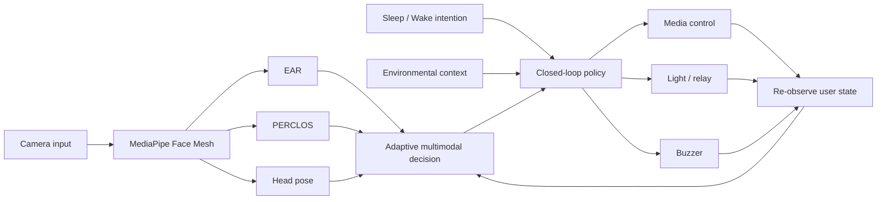
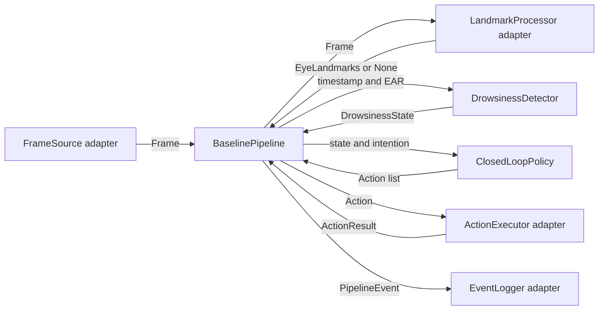

# System Architecture

The research system follows a closed-loop pipeline rather than a one-shot alert.

## Module boundaries

- `detection`: feature extraction, calibration, temporal classification
- `control`: intention-aware state transitions and restoration policy; it emits
  actions but does not directly access GPIO, HTTP, media, or camera APIs
- `pipeline.models`: immutable data passed between modules (`Frame`, eye
  landmarks, EAR/state event, requested actions, and execution results)
- `pipeline.contracts`: environment-independent `Protocol` interfaces for
  `FrameSource`, `LandmarkProcessor`, `DrowsinessDetector`, `ActionExecutor`,
  and `EventLogger`
- `pipeline.runner`: synchronous orchestration only; it owns no camera, MediaPipe,
  network, filesystem, or GPIO implementation
- `adapters`: hardware-free mock and bounded Raspberry Pi HTTP action executors
- `config`: environment-specific values and experimental parameters
- `legacy`: original submitted prototype kept as a reproducible reference
- `data`: consented experiment data; raw data is intentionally ignored by Git
- `results`: generated metrics, tables, and figures; generated files are ignored

## Closed-loop behavior

1. Detect the current state.
2. Select actions using Sleep Aid or Wake-up intention.
3. Actuate media, light, and/or buzzer.
4. Observe the user again.
5. Restore devices or transition policy when the user recovers.

## Baseline contracts and dependency direction

Core detection and policy code depends only on values and contains no adapter
imports. `BaselinePipeline` depends on the five structural interfaces, while
camera/MediaPipe, HTTP/GPIO/media, and persistent logging implementations depend
on those interfaces from the outside. Test fakes therefore use the same public
contracts as production adapters without requiring optional hardware packages.

`Frame.timestamp` is the capture time from a monotonic clock. A missing face is
represented by `LandmarkProcessor.process` returning `None`; the pipeline then
passes `ear=None` to the detector. A `PipelineEvent` records the frame sequence,
timestamp, calculated mean EAR, detected state, requested actions, and every
action result.

## Error policy

- Frame capture, landmark processing, EAR calculation, detection, policy, and
  logging errors propagate to the caller. These failures make the observation
  unreliable or unauditable, so the run controller must stop or restart it.
- `ActionExecutor` should normally return an unsuccessful `ActionResult` for an
  expected device failure. If it raises unexpectedly, the pipeline converts the
  exception to an unsuccessful result and continues executing the remaining
  actions, logging the result, and re-observing the user.
- An executor result for an action other than the requested action is a contract
  violation and raises `ValueError`.

The HTTP executor uses `POST` for state changes, applies the configured timeout,
and reports status, elapsed time, and a stable error reason without logging URLs
or response bodies. See [RASPBERRY_PI_SMOKE_TEST.md](RASPBERRY_PI_SMOKE_TEST.md)
for endpoint and physical-device verification details.
