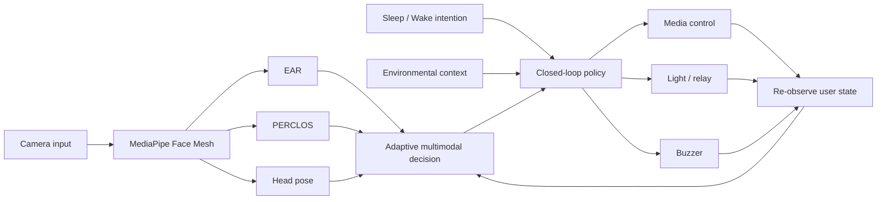

# System Architecture

The research system follows a closed-loop pipeline rather than a one-shot alert.

## Module boundaries

- `detection`: feature extraction, calibration, temporal classification
- `control`: intention-aware state transitions and restoration policy; it emits
  actions but does not directly access GPIO, HTTP, media, or camera APIs
- `config`: environment-specific values and experimental parameters
- `legacy`: original submitted prototype kept as a reproducible reference
- `data`: consented experiment data; raw data is intentionally ignored by Git
- `results`: generated metrics, tables, and figures; generated files are ignored

## Closed-loop behavior

1. Detect the current state.
2. Select actions using Sleep Aid or Wake-up intention.
3. Actuate media, light, and/or buzzer.
4. Observe the user again.
5. Restore devices or transition policy when the user recovers.
